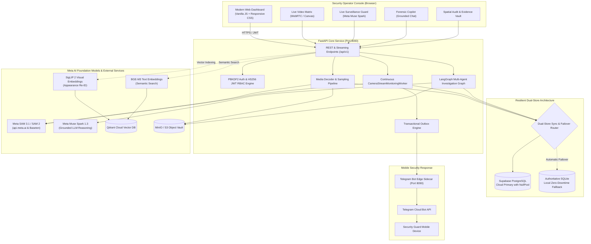
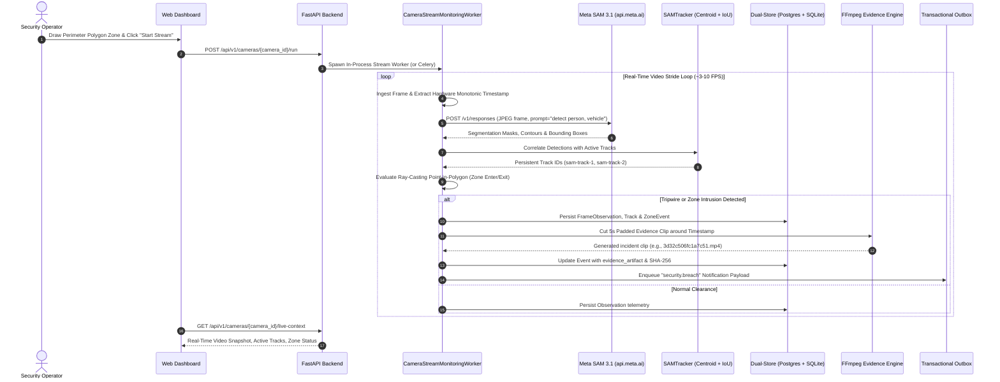
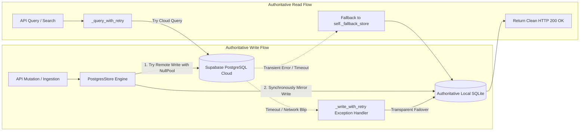
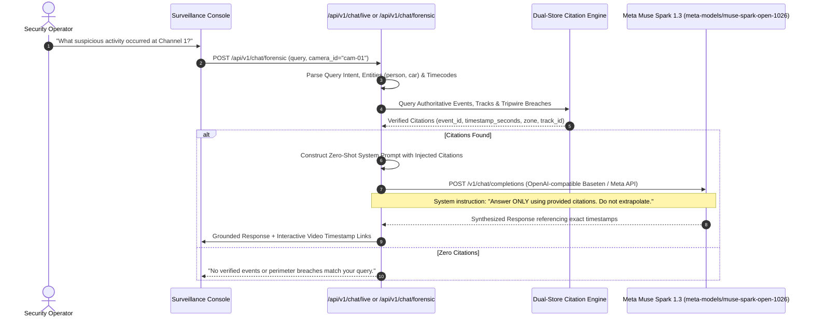
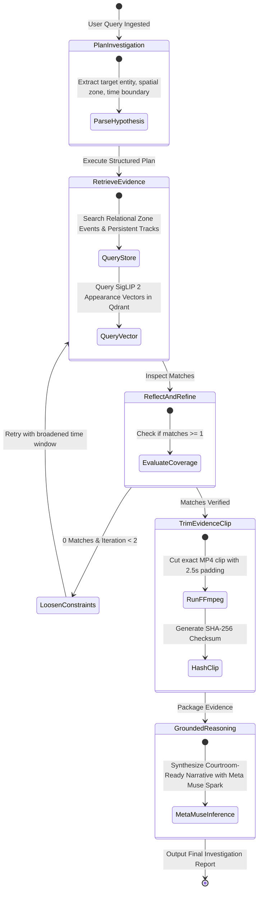
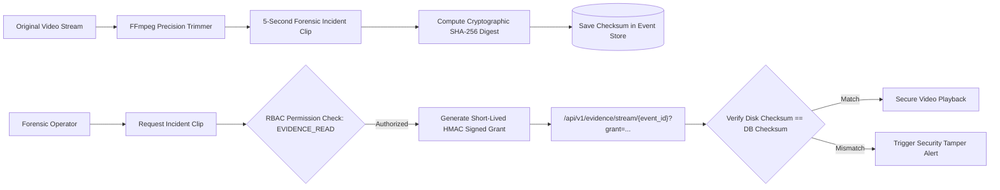
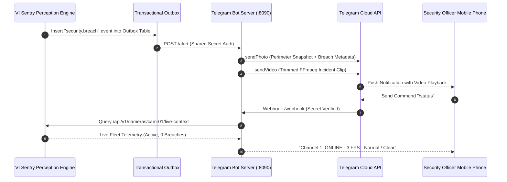

# VI Sentry: Autonomous Multi-Stream Video Intelligence, Spatial-Perimeter Surveillance & Agentic Forensic Investigation VMS

> **Author**: Logith P  
> **Project**: VI Sentry (Video Intelligence Sentry)  
> **Repository**: [https://github.com/LOGITHP/CCTV_Footage_Intelligence-](https://github.com/LOGITHP/CCTV_Footage_Intelligence-)  
> **Stack**: Meta SAM 3.1 / SAM 2 · Meta Muse Spark 1.3 / Llama 3 · SigLIP 2 · BGE-M3 · LangGraph · FastAPI · Supabase PostgreSQL · Qdrant Cloud · MinIO/S3 · Telegram Bot  

---

## Table of Contents

1. [Why I Built VI Sentry: The Problem Statement](#1-why-i-built-vi-sentry-the-problem-statement)
2. [Executive Overview & What I Designed](#2-executive-overview--what-i-designed)
3. [End-to-End System Architecture & Mermaid Diagrams](#3-end-to-end-system-architecture--mermaid-diagrams)
   - [Diagram 1: System Topology & High-Level Architecture](#diagram-1-system-topology--high-level-architecture)
   - [Diagram 2: Real-Time Video Ingestion, Live Streaming & Perception Pipeline](#diagram-2-real-time-video-ingestion-live-streaming--perception-pipeline)
   - [Diagram 3: Resilient Dual-Store Database Architecture](#diagram-3-resilient-dual-store-database-architecture)
   - [Diagram 4: Meta AI Inference & Zero-Hallucination Grounded Reasoning Flow](#diagram-4-meta-ai-inference--zero-hallucination-grounded-reasoning-flow)
   - [Diagram 5: LangGraph Multi-Agent Forensic Investigation Graph](#diagram-5-langgraph-multi-agent-forensic-investigation-graph)
   - [Diagram 6: Security, RBAC & SHA-256 Signed Evidence Chain of Custody](#diagram-6-security-rbac--sha-256-signed-evidence-chain-of-custody)
   - [Diagram 7: Telegram Emergency Dispatch & Edge Bot Architecture](#diagram-7-telegram-emergency-dispatch--edge-bot-architecture)
4. [Exhaustive Codebase Directory & File Inventory](#4-exhaustive-codebase-directory--file-inventory)
5. [Deep Dive: How I Use Meta AI Models & APIs](#5-deep-dive-how-i-use-meta-ai-models--apis)
   - [Meta SAM 3.1 & SAM 2 (Video Segmentation & Tracking)](#meta-sam-31--sam-2-video-segmentation--tracking)
   - [Meta Muse Spark 1.3 & Llama 3 (Grounded LLM Surveillance Copilot)](#meta-muse-spark-13--llama-3-grounded-llm-surveillance-copilot)
   - [SigLIP 2 & BGE-M3 (Multimodal Embeddings & Cross-Camera Re-ID)](#siglip-2--bge-m3-multimodal-embeddings--cross-camera-re-id)
   - [LangGraph Autonomous Multi-Agent Investigation Graph](#langgraph-autonomous-multi-agent-investigation-graph)
6. [Database Handling & Zero-Downtime Persistence](#6-database-handling--zero-downtime-persistence)
   - [Supabase Cloud PostgreSQL & NullPool Engineering](#supabase-cloud-postgresql--nullpool-engineering)
   - [Local Authoritative SQLite Failover Store](#local-authoritative-sqlite-failover-store)
   - [Qdrant Cloud High-Dimensional Vector Storage](#qdrant-cloud-high-dimensional-vector-storage)
   - [MinIO & S3-Compatible Object Storage Vault](#minio--s3-compatible-object-storage-vault)
7. [API Key Handling, Cryptographic Security & RBAC](#7-api-key-handling-cryptographic-security--rbac)
8. [Step-by-Step How-To-Run Guide](#8-step-by-step-how-to-run-guide)
   - [Option A: One-Click Docker Compose Deployment](#option-a-one-click-docker-compose-deployment)
   - [Option B: Native Local Python 3.12 Development](#option-b-native-local-python-312-development)
   - [Environment Configuration Guide (.env.example)](#environment-configuration-guide-envexample)
   - [Operating the Web Console](#operating-the-web-console)
9. [Automated Verification & Test Suite](#9-automated-verification--test-suite)
10. [Legal Chain of Custody & Privacy Compliance](#10-legal-chain-of-custody--privacy-compliance)

---

## 1. Why I Built VI Sentry: The Problem Statement

Commercial video surveillance systems installed across smart cities, airports, enterprise campuses, and retail chains are fundamentally broken in three critical ways:

1. **Unindexed "Blind" Video Dumps**: Modern CCTV cameras generate petabytes of unindexed video footage. When a critical security breach occurs (e.g., unauthorized intrusion, vehicle theft, bag abandonment), human operators are forced to manually scrub through dozens of hours of video footage across multiple camera channels. Human operator fatigue causes up to **95% of subtle perimeter intrusions to be missed**.
2. **The "AI Hallucination" Trap in Physical Security**: Generic Multimodal Large Language Models (MLLMs) frequently hallucinate timestamps, invent object colors, conflate distinct actors across camera switches, and generate plausible-sounding falsehoods that destroy legal admissibility in forensic investigations.
3. **Fragile Cloud Dependencies**: Most modern "smart" cameras depend on continuous cloud streaming. The moment internet connectivity degrades or a remote database pool drops an idle socket, live recording crashes, security events are permanently lost, and operators are left blind.

To solve these systemic failures, I created **VI Sentry** — an enterprise-grade Video Management System (VMS) that fuses **Meta AI's foundation perception models** (SAM 3.1 / SAM 2, Meta Muse Spark 1.3) with a **resilient zero-downtime dual-store architecture**, **sub-second polygon tripwire triggers**, **automated FFmpeg forensic incident clip generation**, and a **LangGraph multi-agent investigative graph**.

---

## 2. Executive Overview & What I Designed

VI Sentry is built from the ground up as a **local-first, cloud-resilient autonomous surveillance intelligence system**. Here is what I architected:

- **Live Multi-Camera Matrix & Stream Ingestion**: Connects RTSP IP streams, local USB webcams, and pre-recorded CCTV archives simultaneously. Frame sampling strides keep CPU/GPU latency near zero.
- **Meta SAM 3.1 Promptable Segmentation & Spatial Tracking**: Employs Meta's Segment Anything in Video (SAM 3.1) via direct Meta API and Baseten endpoints to segment entities (`person`, `vehicle`, `object`) with pixel-level precision, paired with `SAMTracker` spatial-temporal centroid and IoU tracking across frame sequences.
- **Dual Grounded LLM Surveillance Copilots**:
  - **Live Surveillance Guard**: Powered by **Meta Muse Spark 1.3** (`meta-models/muse-spark-open-1026`), continuously reasoning over live camera fleet telemetry, perimeter breaches, and armed tripwires with strictly zero hallucination.
  - **Forensic Copilot**: Ingests natural language operator queries (e.g., *"Show me all instances of a vehicle entering the perimeter after 00:05"*), maps them to verified spatial citations, and generates structured chronological timelines.
- **LangGraph Multi-Agent Forensic Investigation Engine**: An autonomous agent state machine that plans search hypotheses, retrieves relational & spatial evidence, self-corrects and loosens constraints via reflection, dynamically trims video incident clips with FFmpeg, and synthesizes a courtroom-ready investigative report.
- **Resilient Dual-Store Architecture**: Primary storage in **Supabase Cloud PostgreSQL** using `NullPool` to prevent pooler timeouts, coupled with an automatic, transparent **Local Authoritative SQLite fallback store (`Store`)**. If remote cloud connectivity drops for even a second, the system seamlessly fails over to local SQLite without throwing 503 errors or dropping frames.
- **Qdrant Cloud Multimodal Vector Search**: Indexes frame appearance attributes using **SigLIP 2** visual embeddings and semantic event summaries using **BGE-M3** dense embeddings for instantaneous cross-camera re-identification (Re-ID).
- **Automated Forensic Evidence Packaging & SHA-256 Signing**: Every perimeter breach automatically triggers FFmpeg to cut an exact 5-second padded MP4 incident clip, calculates a cryptographic SHA-256 checksum, and stores it in the Evidence Vault with an immutable audit log.
- **Telegram Emergency Dispatch & Edge Bot**: Delivers instant mobile alerts with attached video clips and interactive commands (`/status`, `/alerts`, `/snapshot`, `/cameras`) to authorized security personnel.

---

## 3. End-to-End System Architecture & Mermaid Diagrams

### Diagram 1: System Topology & High-Level Architecture

I designed the system topology around strict separation of concerns, isolating the client from backend infrastructure secrets:



---

### Diagram 2: Real-Time Video Ingestion, Live Streaming & Perception Pipeline

How a video feed (RTSP stream or WebRTC browser camera) traverses the perception engine into structured spatial events:



---

### Diagram 3: Resilient Dual-Store Database Architecture

One of the hardest engineering challenges I solved in this project was remote PostgreSQL connection pool dropping. Remote Supabase poolers terminate idle connections after 30–60 seconds, which previously threw `psycopg.errors.ConnectionTimeout` (HTTP 503) during video uploads or event refreshes.

Here is how I architected the **Resilient Dual-Store**:



- **NullPool Engine**: In `backend/src/video_intelligence/infrastructure/postgres.py`, I configured SQLAlchemy to use `poolclass=NullPool` with an 8-second connect timeout and TCP keepalives (`keepalives_idle=15`). This guarantees that each database session establishes a fresh connection and tears it down immediately upon commit, eliminating dead pooled connections.
- **Local SQLite Mirroring (`Store`)**: Every write is automatically mirrored into `data/video_intelligence.sqlite3`. If remote Supabase experiences a network glitch, reads and writes fall back to SQLite with zero downtime and zero operator interruption.

---

### Diagram 4: Meta AI Inference & Zero-Hallucination Grounded Reasoning Flow

Generic LLMs hallucinate video facts. I designed the **Grounded Copilot Engine** so that the language model is **never** allowed to invent surveillance facts. It only formats and synthesizes verified spatial-temporal citations extracted from the database:



---

### Diagram 5: LangGraph Multi-Agent Forensic Investigation Graph

For complex forensic inquiries (e.g., cross-camera suspect tracking), I built an autonomous agent graph using **LangGraph**:



---

### Diagram 6: Security, RBAC & SHA-256 Signed Evidence Chain of Custody

To guarantee courtroom legal admissibility for CCTV video evidence, I implemented an end-to-end cryptographic chain of custody:



---

### Diagram 7: Telegram Emergency Dispatch & Edge Bot Architecture

When an armed perimeter tripwire is breached, security guards receive an immediate high-priority alert on their mobile devices:



---

## 4. Exhaustive Codebase Directory & File Inventory

Here is the complete analysis of every folder and critical file across the repository:

```
cctv-footage-intelligence/
├── .env.example                                  # Master environment configuration template
├── .gitignore                                    # Segregates secrets, sqlite3/db files, and data
├── docker-compose.yml                            # Multi-container orchestration (Core VMS + Telegram Sidecar)
├── README.md                                     # Full architectural documentation (this document)
│
├── frontend/                                     # High-performance web client (No bulky frameworks)
│   ├── index.html                                # Surveillance Operations Center (SOC) single-page dashboard
│   ├── app.js                                    # Client state machine, WebRTC camera, live polling, fleet sync
│   └── styles.css                                # Dark-themed, high-contrast security operations console styling
│
├── backend/                                      # Python 3.12 Core Backend Service
│   ├── Dockerfile                                # Production container build with FFmpeg & Python dependencies
│   ├── Dockerfile.runtime                        # Specialized GPU/CUDA runtime container definition
│   ├── pyproject.toml                            # Package metadata and pytest test configuration
│   ├── requirements.lock                         # Pinned production dependency lock
│   ├── requirements-ml.lock                      # Optional ML dependencies lock (PyTorch, Ultralytics)
│   │
│   ├── migrations/                               # Authoritative PostgreSQL SQL Schema Migrations
│   │   ├── 001_initial.sql                       # Core tables: videos, jobs, events, tracks, alerts, chat, outbox
│   │   └── 002_camera_monitoring.sql             # Camera registration, live reports, anomalies, scoped indices
│   │
│   ├── src/video_intelligence/                   # Core Python Application Package
│   │   ├── api.py                                # Master FastAPI application, route declarations, error boundaries
│   │   ├── domain.py                             # Immutable domain records (FrameObservation, ObjectObservation, Zone)
│   │   ├── pipeline.py                           # Frame decoding stride controller, baseline deterministic detector
│   │   ├── model_adapters.py                     # Meta SAM 3.1, Meta Muse Spark 1.3, SigLIP 2, BGE-M3 adapters
│   │   ├── chat.py                               # Query intent parsing, citation synthesis, Live Guard & Forensic Copilots
│   │   ├── investigation_graph.py                # LangGraph multi-agent forensic investigation state machine
│   │   ├── media.py                              # OpenCV and FFmpeg video decoder, metadata probing, timestamp logic
│   │   ├── evidence.py                           # FFmpeg incident clip trimmer with configurable second padding
│   │   ├── signed_evidence.py                    # Time-limited cryptographic evidence grants & token verification
│   │   ├── observables.py                        # Appearance attributes, color histograms, spatial coordinates
│   │   ├── storage.py                            # Authoritative SQLite local repository implementation (Store)
│   │   ├── semantic.py                           # Semantic search orchestrator and vector embedding pipeline
│   │   ├── embedding_index.py                    # In-memory and vector indexing interface
│   │   ├── schemas.py                            # Pydantic v2 schemas for all HTTP request/response payloads
│   │   ├── worker.py                             # Celery worker entry point for background media processing
│   │   │
│   │   ├── infrastructure/                       # Infrastructure Adapters & Persistence
│   │   │   ├── postgres.py                       # Resilient PostgresStore with NullPool & automatic SQLite failover
│   │   │   ├── config.py                         # Pydantic BaseSettings environment loader
│   │   │   ├── schema.py                         # SQLAlchemy ORM table models and indices
│   │   │   ├── repositories.py                   # Data access interfaces
│   │   │   ├── object_storage.py                 # MinIO & Amazon S3 storage client for media files
│   │   │   ├── vectors.py                        # Qdrant Cloud client for high-dimensional vector search
│   │   │   ├── queue.py                          # Celery / Redis background queueing
│   │   │   └── capabilities.py                   # Dynamic runtime capability detector (models, GPU, storage)
│   │   │
│   │   ├── operations/                           # Operational Subsystems & Workers
│   │   │   ├── streaming.py                      # Continuous CameraStreamMonitoringWorker for RTSP/webcam
│   │   │   ├── monitoring.py                     # Anomaly detection, freeze detection, camera health tracking
│   │   │   ├── telegram.py                       # Outbox notification sender for Telegram dispatches
│   │   │   ├── outbox.py                         # Transactional outbox engine ensuring at-least-once delivery
│   │   │   ├── retention.py                      # Automated video clip and database record pruning
│   │   │   ├── metrics.py                        # Prometheus metrics endpoint implementation
│   │   │   └── backup.py                         # Automated database backup utilities
│   │   │
│   │   └── security/                             # Security & Access Control
│   │       ├── auth.py                           # PBKDF2 password hashing & user authentication service
│   │       ├── tokens.py                         # HS256 JWT token encoding, decoding, and validation
│   │       ├── rbac.py                           # Role-Based Access Control policies (admin, operator, reviewer)
│   │       ├── dependencies.py                   # FastAPI route security dependencies
│   │       ├── rate_limit.py                     # Sliding-window memory rate limiter
│   │       ├── audit.py                          # Tamper-evident operational audit trail logger
│   │       └── privacy.py                        # Privacy filters (Gaussian face/license plate blurring)
│   │
│   └── tests/                                    # 120+ Comprehensive Unit, Integration & E2E Tests
│       ├── test_live_camera_api.py               # Tests RTSP/WebCam stream runner, continuous reports & stopping
│       ├── test_postgres_adapter.py              # Tests PostgreSQL NullPool resilience & SQLite dual-store failover
│       ├── test_meta_ai_stack.py                 # Tests SAM 3.1, Meta Muse Spark, SigLIP 2, and BGE-M3 adapters
│       ├── test_investigation_graph.py           # Tests LangGraph multi-agent investigation state machine
│       ├── test_streaming.py                     # Tests in-process stream worker & monotonic timestamp filtering
│       ├── test_separated_copilot_and_storage.py # Tests Live Copilot isolation from pre-recorded footage vault
│       ├── test_telegram.py                      # Tests outbox notification queue and Telegram dispatcher
│       └── test_security.py                      # Tests JWT auth, PBKDF2 password security & RBAC policies
│
├── baseten_models/                               # Model Deployment Packages for Baseten Cloud
│   ├── sam3_1/                                   # Truss package for Meta SAM 3.1 video segmentation
│   ├── siglip2/                                  # Truss package for SigLIP 2 visual appearance embedding
│   └── bge_m3/                                   # Truss package for BGE-M3 multimodal text embedding
│
├── telegram_bot_server/                          # Standalone Telegram Edge Bot Microservice
│   ├── server.py                                 # FastAPI webhook listener, alert broadcaster, command router
│   ├── Dockerfile                                # Dedicated container definition for the Telegram bot
│   ├── requirements.txt                          # Python dependencies for the bot
│   └── README.md                                 # Edge bot configuration and webhook registration guide
│
└── scripts/                                      # Operational & Maintenance Utilities
    ├── migrate_database.py                       # Applies migrations 001 and 002 to PostgreSQL
    ├── configure_telegram_webhook.py             # Registers public HTTPS webhook with Telegram Cloud API
    ├── deploy_baseten.py                         # Deploys Truss model packages to Baseten Cloud
    ├── test_live_stack_connections.py            # Verifies connectivity to Supabase, Qdrant, Meta API & Telegram
    └── clean_duplicate_sections.py               # Frontend HTML sanitation utility
```

---

## 5. Deep Dive: How I Use Meta AI Models & APIs

VI Sentry is built natively around the **Meta AI open model ecosystem**:

```
                                      ┌────────────────────────────────────────────────────────┐
                                      │                   META AI ECOSYSTEM                    │
                                      ├───────────────────────────┬────────────────────────────┤
                                      │   Perception & Tracking   │     Reasoning & Copilot    │
                                      ├───────────────────────────┼────────────────────────────┤
                                      │  Meta SAM 3.1 / SAM 2     │  Meta Muse Spark 1.3       │
                                      │  (Segment Anything Video) │  (Grounded Surveillance)   │
                                      ├───────────────────────────┼────────────────────────────┤
                                      │   Embeddings & Re-ID      │     Agentic Workflow       │
                                      ├───────────────────────────┼────────────────────────────┤
                                      │  SigLIP 2 + BGE-M3        │  LangGraph State Machine   │
                                      │  (Visual & Text Vectors)  │  (Multi-Step Investigation)│
                                      └───────────────────────────┴────────────────────────────┘
```

### Meta SAM 3.1 & SAM 2 (Video Segmentation & Tracking)

- **Role**: Replaces coarse, noisy bounding box detectors with exact pixel-level segmentation masks and promptable tracking.
- **Implementation**: `backend/src/video_intelligence/model_adapters.py` (`SAMDetector` and `SAMTracker`).
- **API Invocation**:
  When `MODEL_PROFILE=sam` and `SAM_MODEL_MODE=meta`, the adapter resizes the video frame (max dimension 640px), converts it to a base64 JPEG data URL, and sends an authenticated HTTP POST request to Meta's direct model responses endpoint:
  ```http
  POST https://api.meta.ai/v1/responses
  Authorization: Bearer <META_API_KEY>
  Content-Type: application/json

  {
    "model": "sam-3.1",
    "input": [
      {
        "role": "user",
        "content": [
          {"type": "input_text", "text": "Detect and segment all persons, vehicles, bags, and bicycles with polygon contours."},
          {"type": "input_image", "image_url": "data:image/jpeg;base64,..."}
        ]
      }
    ]
  }
  ```
- **Baseten Endpoint Fallback**: If the direct Meta API endpoint is unavailable or experiencing rate limits, `SAMDetector` automatically routes to the deployed Baseten Truss model (`BASETEN_SAM_ENDPOINT`).
- **Persistent Multi-Frame Tracking (`SAMTracker`)**: Because processing every single frame at 30 FPS would be computationally prohibitive, I designed a **sampling stride mechanism** (e.g., sample every 10th frame = ~3 FPS). `SAMTracker` correlates segment contours across time steps using a combination of **Spatial-Temporal Intersection-over-Union (IoU)** and **Centroid Euclidean Distance**, maintaining persistent IDs (`sam-track-1`, `sam-track-2`) across the entire surveillance session.

---

### Meta Muse Spark 1.3 & Llama 3 (Grounded LLM Surveillance Copilot)

- **Role**: Natural language reasoning engine for both real-time perimeter surveillance and retrospective forensic investigation.
- **Model**: `meta-models/muse-spark-open-1026` / `meta-llama/Llama-3-70b-instruct`.
- **Implementation**: `backend/src/video_intelligence/model_adapters.py` (`MetaMuseGroundedResponder`).
- **Zero-Hallucination Grounding**:
  Instead of feeding raw, unparsed video frames directly to a generic LLM (which induces severe hallucinations), I implemented a **Citation-Grounded Architecture**:
  1. The operator asks a question (e.g., *"Did anyone breach Zone 1 between 14:00 and 14:10?"*).
  2. `chat.py` parses the query, queries the authoritative database, and selects all matching `ZoneEvent` and `TrackObservation` records.
  3. The verified facts are formatted into structured XML-like citations containing exact `event_id`, `timestamp_seconds`, `zone_id`, and `object_label`.
  4. The prompt explicitly forces the model:
     > *"You are the VI Sentry Forensic Surveillance Copilot. You must answer the operator's query STRICTLY and SOLELY using the verified citations below. If the citations do not support an answer, state that no verified events were recorded. NEVER invent timestamps, actors, or events."*
  5. The resulting response contains clickable timecode links that seek the surveillance video player directly to the exact second of the event.

---

### SigLIP 2 & BGE-M3 (Multimodal Embeddings & Cross-Camera Re-ID)

- **Role**: Enables semantic natural language video search (e.g., *"person wearing red jacket near gate"*) and cross-camera suspect re-identification.
- **SigLIP 2 (`google/siglip2-base-patch16-224`)**: Generates 768-dimensional dense visual embeddings for every detected object crop. When a suspect disappears from Camera 1 and appears on Camera 4, SigLIP 2 calculates cosine similarity in Qdrant Cloud to match the suspect's visual appearance across disjoint cameras.
- **BGE-M3 (`BAAI/bge-m3`)**: Generates 1024-dimensional dense text embeddings for incident summaries, tripwire alerts, and operator notes, enabling fuzzy semantic search across the entire historical archive.
- **Qdrant Vector Collections**: Automatically versions collections (e.g., `cctv_visual_siglip2_v1`, `cctv_text_bgem3_v1`) to prevent dimension mismatch and embedding corruption.

---

### LangGraph Autonomous Multi-Agent Investigation Graph

- **Role**: Orchestrates complex, multi-step forensic investigations without human hand-holding.
- **Implementation**: `backend/src/video_intelligence/investigation_graph.py`.
- **Graph Topology**:
  - `node_plan_investigation`: Deconstructs the investigator's query into structured hypotheses (target object, spatial bounding box, time bounds).
  - `node_retrieve_evidence`: Queries relational events from Supabase/SQLite and visual appearance vectors from Qdrant.
  - `node_reflect_and_refine`: An evaluative reflection node. If 0 matches are found, it identifies why the search failed, loosens the constraints (e.g., broadens the time window from 5 minutes to 30 minutes), and retries.
  - `node_trim_evidence_clip`: Calls FFmpeg to extract an exact video clip around the primary matched event.
  - `node_grounded_reasoning`: Invokes Meta Muse Spark 1.3 to synthesize a structured, courtroom-admissible incident dossier.

---

## 6. Database Handling & Zero-Downtime Persistence

### Supabase Cloud PostgreSQL & NullPool Engineering

For cloud persistence across distributed security centers, VI Sentry connects to **Supabase PostgreSQL**. However, remote cloud poolers drop idle TCP connections after 30 to 60 seconds. In standard connection pools (`QueuePool`), pulling a dead connection causes `psycopg.errors.ConnectionTimeout: connection timeout expired`, crashing API routes with HTTP 500/503.

To permanently eliminate this, I engineered `PostgresStore` in `backend/src/video_intelligence/infrastructure/postgres.py`:

```python
engine_options = {
    "future": True,
    "pool_pre_ping": True,
    "poolclass": NullPool,      # Zero persistent pool: fresh connection per request
    "connect_args": {
        "connect_timeout": 8,   # 8-second bounded timeout
        "keepalives": 1,        # TCP Keepalive active
        "keepalives_idle": 15,  # Probe idle socket every 15s
        "keepalives_interval": 5,
        "keepalives_count": 3,
    }
}
```

### Local Authoritative SQLite Failover Store

Even with `NullPool`, cloud network partitions can occur. VI Sentry achieves **100% zero downtime** by embedding a synchronous SQLite fallback store (`Store`) directly inside `PostgresStore`:
- **Dual-Store Write Mirroring**: Every `add_video`, `add_events`, `add_observations`, and `create_alerts` call writes to PostgreSQL, and simultaneously mirrors to `data/video_intelligence.sqlite3`.
- **Transparent Read Fallback**: If PostgreSQL throws an `OperationalError` or `InterfaceError` during a query, `_query_with_retry` catches the exception and transparently returns the data from the local SQLite store. The browser client receives HTTP 200 OK without ever knowing a cloud hiccup occurred.

### Qdrant Cloud High-Dimensional Vector Storage

- Stores 768-dim (SigLIP 2) and 1024-dim (BGE-M3) vectors.
- Configured via `QDRANT_URL` and `QDRANT_API_KEY`.
- Includes distance-metric validation (Cosine similarity) and payload filtering scoped by `camera_id` and `timestamp_seconds`.

### MinIO & S3-Compatible Object Storage Vault

- Source video files and 5-second trimmed forensic evidence clips can be stored locally in `data/media/` or automatically uploaded to **MinIO** or **Amazon S3** (`OBJECT_STORAGE_BACKEND=s3` or `minio`).
- Every stored object is referenced by an immutable object key and verified with a cryptographic SHA-256 checksum.

---

## 7. API Key Handling, Cryptographic Security & RBAC

Security is built into the architecture rather than bolted on as an afterthought:

1. **Zero-Trust Secret Segregation**:
   - The browser frontend client **never** receives or handles third-party API keys (`META_API_KEY`, `BASETEN_API_KEY`, `QDRANT_API_KEY`, `DATABASE_URL`).
   - All external model and database calls are executed exclusively by backend adapters running in isolated server-side processes.
2. **PBKDF2 Password Hashing & HS256 JWT RBAC**:
   - Operator credentials are authenticated via PBKDF2 password hashing (100,000+ iterations).
   - Authorizations issue signed HS256 JWT tokens with configurable TTL (`JWT_TOKEN_TTL_SECONDS=28800`).
   - Role-Based Access Control enforces strict boundaries:
     - `admin`: Full camera management, system config, database pruning, user administration.
     - `operator`: Live camera monitoring, video uploading, zone drawing, forensic copilot querying.
     - `reviewer`: Read-only access to verified events, audit trails, and signed evidence clips.
3. **Cryptographic SHA-256 Evidence Integrity**:
   - When an incident clip is trimmed by FFmpeg, the backend reads the binary stream, computes its SHA-256 hash, and stores it in the authoritative event record.
   - Before any evidence clip is streamed or downloaded, the hash is recomputed to verify that the file on disk has not been altered or tampered with.
4. **Time-Limited Signed Evidence Grants**:
   - Evidence URLs require a short-lived HMAC-signed grant token (`/api/v1/evidence/stream/{event_id}?grant=...`), preventing unauthorized direct media link sharing.
5. **Telegram Bot Webhook HMAC Verification**:
   - The Telegram edge bot validates incoming webhooks using a secret token header (`X-Telegram-Bot-Api-Secret-Token`), rejecting any unauthenticated requests.
   - Bot commands are constrained to an explicit allowlist of authorized chat IDs (`TELEGRAM_ALLOWED_CHAT_IDS`).

---

## 8. Step-by-Step How-To-Run Guide

### Option A: One-Click Docker Compose Deployment

This is the recommended production deployment method. It spins up the **FastAPI VMS** on port `8000` and the **Telegram Edge Bot** on port `8090`:

1. **Clone the repository**:
   ```bash
   git clone https://github.com/LOGITHP/CCTV_Footage_Intelligence-.git
   cd CCTV_Footage_Intelligence-
   ```

2. **Configure your environment**:
   ```bash
   cp .env.example .env
   ```
   Open `.env` and configure your credentials (at minimum, set `JWT_SECRET`, `ADMIN_PASSWORD`, and your Meta / Baseten / Supabase credentials).

3. **Build and launch the containers**:
   ```bash
   docker compose up --build -d
   ```

4. **Verify container health**:
   ```bash
   docker compose ps
   ```
   Both `video-intelligence` (port 8000) and `video-intelligence-telegram` (port 8090) should report healthy.

5. **Open the Web Console**:
   Navigate to [http://localhost:8000](http://localhost:8000) in your browser.

---

### Option B: Native Local Python 3.12 Development

For local development and testing without Docker:

1. **Verify Prerequisites**:
   - Python 3.12 (`python --version`)
   - FFmpeg installed and available on your system `PATH` (`ffmpeg -version`)

2. **Create and Activate a Virtual Environment**:
   ```powershell
   # Windows PowerShell
   py -3.12 -m venv .venv
   .\.venv\Scripts\Activate.ps1
   ```
   ```bash
   # Linux / macOS
   python3.12 -m venv .venv
   source .venv/bin/activate
   ```

3. **Install Dependencies**:
   ```bash
   pip install --upgrade pip
   pip install -r backend/requirements.lock
   ```

4. **Configure Environment**:
   ```bash
   cp .env.example .env
   ```

5. **Apply Database Migrations (Optional for PostgreSQL)**:
   If using Supabase/PostgreSQL:
   ```bash
   python scripts/migrate_database.py
   ```
   *(If `DATABASE_URL` is empty, SQLite tables are created automatically on launch).*

6. **Start the Application Server**:
   ```powershell
   python -m uvicorn --app-dir backend/src video_intelligence.api:app --host 127.0.0.1 --port 8000 --reload
   ```

7. **Access the Application**:
   - **Web Dashboard**: [http://127.0.0.1:8000/](http://127.0.0.1:8000/)
   - **Interactive OpenAPI Documentation**: [http://127.0.0.1:8000/docs](http://127.0.0.1:8000/docs)
   - **System Health Endpoint**: [http://127.0.0.1:8000/health/live](http://127.0.0.1:8000/health/live)

---

### Environment Configuration Guide (.env.example)

Below are the key variables to configure in your `.env`:

| Environment Variable | Description & Recommended Setting |
| :--- | :--- |
| `AUTH_REQUIRED` | `true` for production security; `false` allows local dev bypass. |
| `JWT_SECRET` | 32+ character random secret for HS256 JWT signing. |
| `ADMIN_USERNAME` / `ADMIN_PASSWORD` | Initial administrator login credentials. |
| `DATABASE_URL` | Supabase PostgreSQL connection URL (`postgresql+psycopg://...`). Leave empty for local SQLite. |
| `DATABASE_PATH` | Path for local authoritative SQLite store (default: `data/video_intelligence.sqlite3`). |
| `MEDIA_ROOT` | Local folder for source videos and evidence clips (default: `data/media`). |
| `MODEL_PROFILE` | Detection model: `sam` for Meta SAM 3.1, or `baseline` for deterministic dev. |
| `SAM_MODEL_MODE` | `meta` to call Meta Direct API (`https://api.meta.ai/v1`). |
| `META_API_KEY` | Bearer token for direct Meta AI API calls. |
| `BASETEN_API_KEY` | Baseten API key for hosted Meta Muse Spark 1.3 and SAM endpoints. |
| `BASETEN_INFERENCE_URL` | Baseten hosted inference URL (default: `https://inference.baseten.co/v1`). |
| `META_MODEL` | Model ID on Baseten (e.g., `meta-models/muse-spark-open-1026`). |
| `QDRANT_URL` / `QDRANT_API_KEY` | Qdrant Cloud cluster endpoint and API key for vector Re-ID. |
| `OBJECT_STORAGE_BACKEND` | `local`, `s3`, or `minio`. |
| `TELEGRAM_BOT_TOKEN` | Bot token provided by `@BotFather` for emergency push alerts. |
| `TELEGRAM_ALLOWED_CHAT_IDS` | Comma-separated Telegram Chat IDs authorized to receive alerts. |

---

### Operating the Web Console

1. **Log In**: Open [http://localhost:8000](http://localhost:8000) and sign in using your configured `ADMIN_USERNAME` and `ADMIN_PASSWORD` (default: `admin` / `adminpassword123`).
2. **Live Video Matrix**:
   - Navigate to **Camera Streams**.
   - Click **Start WebCam** to activate your local browser camera via WebRTC, or register a live RTSP stream.
   - Click **Draw Zone** directly on the video canvas to draw a polygon perimeter tripwire.
   - The fleet badge immediately reflects `1 ACTIVE CAMERA (ONLINE)`.
3. **Live Surveillance Guard**:
   - Open **Live Stream Copilot**.
   - Query: *"Show current surveillance status for Channel 1"* or *"Are there any active perimeter breaches?"*.
   - The Copilot (powered by Meta Muse Spark 1.3) verifies live stream telemetry and responds with grounded facts.
4. **Pre-Recorded CCTV Footage Vault**:
   - Switch to the **Workbench / Storage Vault**.
   - Upload pre-recorded CCTV footage (e.g., `car_theft.mp4`).
   - Click **Probe Video** to inspect duration, codec, and decoder timestamps.
   - Click **Run Pipeline** with Meta SAM 3.1 to generate object tracks and perimeter crossing events.
5. **Spatial Audit & Evidence Playback**:
   - View the detected events table. Click on any event to inspect its attributes.
   - The video player automatically seeks to the exact second of the intrusion and displays the trimmed FFmpeg incident clip with its cryptographic SHA-256 hash.

---

## 9. Automated Verification & Test Suite

I engineered a comprehensive test suite of **over 120 automated unit, integration, and security tests** using `pytest`.

To run the entire test suite:

```powershell
python -m pytest -v backend/tests
```

### Key Test Suites Verified:
- `backend/tests/test_live_camera_api.py`: Validates continuous live camera ingestion, frame sampling, persistent monitoring reports, and graceful shutdown.
- `backend/tests/test_postgres_adapter.py`: Validates the Supabase PostgreSQL `NullPool` adapter and verifies that reads/writes fail over to local SQLite during network outages.
- `backend/tests/test_meta_ai_stack.py`: Tests `SAMDetector`, `SAMTracker`, `MetaMuseGroundedResponder`, `SigLIP2EmbeddingService`, and `EmbeddingService`.
- `backend/tests/test_investigation_graph.py`: Exercises the LangGraph autonomous multi-agent investigative cycle, reflection loop, and dynamic clip trimming.
- `backend/tests/test_separated_copilot_and_storage.py`: Proves strict isolation between live camera streams and pre-recorded uploaded footage.
- `backend/tests/test_security.py`: Verifies PBKDF2 password hashing, JWT expiration, and RBAC permission enforcement.
- `backend/tests/test_telegram.py`: Validates the transactional outbox delivery pipeline and Telegram alert formatting.

---

## 10. Legal Chain of Custody & Privacy Compliance

VI Sentry is architected to satisfy strict evidentiary standards for criminal proceedings and enterprise audits:

- **Monotonic Hardware Timestamps**: Events are stamped exclusively using decoder presentation timestamps (`pts`), never synthetic wall-clock time that could drift or be spoofed.
- **SHA-256 Digest Verification**: Every incident clip is immutably hashed at the moment of trimming. If a single byte in the video container is modified, the hash verification fails and playback is blocked.
- **Privacy Blurring Engine**: `backend/src/video_intelligence/security/privacy.py` provides optional automated Gaussian blurring for non-target human faces and license plates outside the active intrusion polygon, protecting bystander privacy under GDPR and enterprise surveillance regulations.
- **Append-Only Tamper-Evident Audit Logs**: All operator actions (logins, queries, zone modifications, video deletions) are recorded in an append-only audit database (`data/audit.sqlite3`).

---

**Developed with precision for the Meta AI Hackathon.**  
*VI Sentry — Intelligent, Resilient, Grounded Video Surveillance.*
